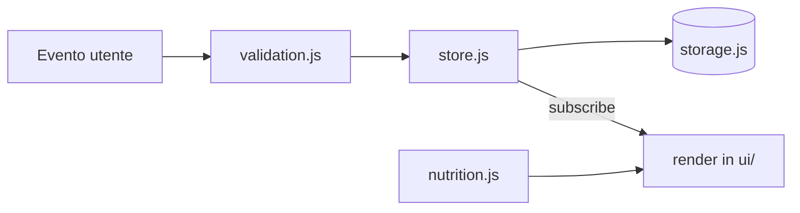

# Fitkia

> Diario alimentare e monitoraggio delle calorie, **mobile-first** e **offline-first**.
> Stato del progetto: 🚧 in sviluppo (pre-alpha)

<Todo assignee="Mattia">
 Un app free che si differenzia da tutte tenendo in locale tutti i dati.

## Indice

1. [Funzionalità](#funzionalità)
2. [Stack tecnologico](#stack-tecnologico)
3. [Architettura](#architettura)
4. [Modello dei dati](#modello-dei-dati)
5. [Per iniziare](#per-iniziare)
6. [Convenzioni](#convenzioni)
7. [PWA e offline](#pwa-e-offline)
8. [Privacy](#privacy)
9. [Roadmap](#roadmap)
10. [Decisioni architetturali](#decisioni-architetturali)
11. [Crediti e licenza](#crediti-e-licenza)

## Funzionalità

Legenda: ✅ fatto · 🚧 in corso · ⬜ da fare

**MVP**
- 🚧 Onboarding: nome, età, peso, altezza (cm), sesso, obiettivo
- 🚧 Calcolo del fabbisogno (BMR Mifflin-St Jeor, TDEE, obiettivo perdere/mantenere/aumentare)
- 🚧 Dashboard: anello calorie (obiettivo / consumate / rimanenti) e macro (proteine, carboidrati, grassi)
- ⬜ Diario pasti: colazione, pranzo, cena, snack
- ⬜ Ricerca alimenti nel dizionario locale con calcolo dinamico per grammatura
- ⬜ Water tracker
- ⬜ Weight log con storico
- ⬜ Impostazioni (ricalcolo dei target)

**Dopo l'MVP**
- ⬜ To-do giornaliera integratori (es. creatina)
- ⬜ Integrazione Open Food Facts e scansione barcode
- ⬜ Pacchetto Android (Capacitor)

<Todo assignee="Mattia">
  Riordina le voci in base alle tue priorità e sposta in "Dopo l'MVP" ciò che non serve alla prima versione. Un MVP è la versione più piccola che sia *davvero utile a te*.
</Todo>

<Todo assignee="Mattia">
  Aggiungi uno screenshot della dashboard (`docs/dashboard.png`). Puoi usare standard img tag o next/image se usi Next.js!
</Todo>

## Stack tecnologico

| Cosa | Scelta | Perché |
|---|---|---|
| Markup | HTML5 semantico | Accessibilità e SEO di base senza dipendenze |
| Stile | Tailwind CSS (CLI, **compilato**) | Design token in un solo posto; il CDN non è per la produzione e rompe l'offline |
| Logica | JavaScript ES2022 (moduli nativi) | Imparare i fondamentali prima di un framework |
| Dati | `localStorage` (v1) → IndexedDB | Semplice all'inizio; migrabile perché isolato in `storage.js` |
| Offline | Service Worker + Web App Manifest | Installabile e usabile senza rete |
| Test | `node:test` | Zero dipendenze per la logica pura |
| Android | Capacitor (più avanti) | Riusa la stessa web app in una WebView |

## Architettura

### Principio guida

**Core puro, bordi impuri.** I calcoli non sanno che esiste una pagina; tutto ciò che tocca browser (DOM, storage, rete) sta in pochi file di confine.

### Flusso dei dati (a una direzione)



`UI = f(stato)`: la pagina è una rappresentazione dello stato, mai la sua fonte.

### Struttura delle cartelle

```text
fitkia/
├── index.html
├── manifest.webmanifest
├── sw.js
├── src/
│   ├── config.js        # costanti, limiti, unità
│   ├── nutrition.js     # logica pura: BMR, target, anello, macro
│   ├── validation.js    # logica pura: form grezzo -> dati tipizzati
│   ├── storage.js       # unico file che tocca localStorage
│   ├── store.js         # stato + pub/sub
│   ├── main.js          # bootstrap
│   └── ui/              # DOM: onboarding, dashboard, ...
└── test/
```

### Regole di dipendenza

- `config.js` non importa nessuno.
- `nutrition.js` e `validation.js` importano solo `config.js` (niente DOM, niente storage).
- `storage.js` importa solo `config.js`.
- `store.js` importa `storage.js` e `config.js`.
- `ui/*` può importare `store`, `nutrition`, `validation`; **nessun altro modulo importa `ui/*`**.
- Solo `main.js` collega le parti.

<Todo assignee="Mattia">
  Aggiungi una regola che ti sembra mancante e spiega perché.
</Todo>

## Modello dei dati

Unità fisse, scritte nei nomi: **kg**, **cm**, **kcal**, **g**.

```js
// Profilo (v1)
{ name, age, weightKg, heightCm, sex: 'male' | 'female', activity, goal }
```

<Todo assignee="Mattia">
  Descrivi qui le altre entità: `FoodEntry` (cosa conservi di un alimento aggiunto: id, nome, grammi, kcal e macro "snapshot"?), `DayLog` (pasti di un giorno), `WeightEntry`, `WaterLog`. Chiediti per ognuna: qual è la chiave? quali campi sono derivati e non vanno salvati?
</Todo>

## Per iniziare

```bash
npm run dev    # serve la cartella (i moduli ES non funzionano da file://)
npm test       # esegue i test della logica pura
```

<Todo assignee="Mattia">
  Quando aggiungerai la build di Tailwind, documenta qui il comando.
</Todo>

## Convenzioni

- Funzioni e variabili `camelCase`, costanti `UPPER_SNAKE`, id HTML `kebab-case`.
- Ogni grandezza fisica ha l'unità nel nome (`heightCm`, `weightKg`).
- Una costante o chiave di storage si definisce **una sola volta** in `config.js`.
- Commit in stile [Conventional Commits](https://www.conventionalcommits.org/it/) (`feat:`, `fix:`, `refactor:`, `test:`, `docs:`).

## PWA e offline

- App shell in precache (HTML, CSS, JS, icone, font self-hosted), cache con nome versionato.
- Asset statici: cache-first. API esterne (Open Food Facts): network-first con fallback.
- Pulizia delle vecchie cache in `activate`; avviso "nuova versione disponibile" invece di aggiornare di colpo.

<Todo assignee="Mattia">
  Aggiungi una sezione "Come testare l'offline" (DevTools → Application → Service Workers → Offline).
</Todo>

## Privacy

Fitkia tratta dati sulla salute. Scelta di progetto: **tutto resta sul dispositivo**, nessun account, nessun invio a server. Le stime caloriche non sono consigli medici.

<Todo assignee="Mattia">
  Aggiungi export/cancellazione dei dati alla roadmap e decidi come mostrare l'avviso all'utente.
</Todo>

## Roadmap

| Milestone | Contenuto | Stato |
|---|---|---|
| **M0 Fondamenta** | README, `config`, `nutrition`, `validation`, `storage`, `store`, test | 🚧 |
| **M1 Onboarding + Dashboard** | Form validato, persistenza, anello e macro dallo stato | ⬜ |
| **M2 Diario** | Dizionario cibi, ricerca, grammatura, aggiunta al pasto | ⬜ |
| **M3 Salute quotidiana** | Acqua, peso, impostazioni, to-do integratori | ⬜ |
| **M4 PWA vera** | Tailwind compilato, font locali, manifest, icone, SW completo | ⬜ |
| **M5 Dati esterni** | Open Food Facts, barcode | ⬜ |
| **M6 Android** | Capacitor, notifiche locali | ⬜ |

<Todo assignee="Mattia">
  Per ogni milestone scrivi un "criterio di fatto" (es. M1: "ricarico la pagina e ritrovo i miei dati").
</Todo>

## Decisioni architetturali

Breve registro del *perché* delle scelte, per ricordarle fra sei mesi.

| # | Decisione | Motivo | Compromesso |
|---|---|---|---|
| 1 | Vanilla JS con moduli ES, senza framework | Capire i fondamentali | Il rendering va scritto a mano |
| 2 | Logica pura separata dal DOM | Testabile senza browser | Più file e più indirezione |
| 3 | Un unico store con pub/sub | Una sola fonte di verità | Ridisegna intere sezioni a ogni cambio |
| 4 | `localStorage` isolato in `storage.js` | Migrare a IndexedDB toccando un file | Sincrono e limitato (~5 MB) |
| 5 | Tailwind compilato, non CDN | Offline e prestazioni | Serve un passo di build |

<Todo assignee="Mattia">
  Aggiungi la decisione n. 6 con le tue parole (es. perché `heightCm` e non metri).
</Todo>

## Crediti e licenza

- Dati alimentari futuri: [Open Food Facts](https://world.openfoodfacts.org/) (licenza ODbL: va citata la fonte).
- Font: Plus Jakarta Sans.

<Todo assignee="Mattia">
  Scegli una licenza per il codice (MIT è la più comune) e aggiungi il file `LICENSE`.
</Todo>
