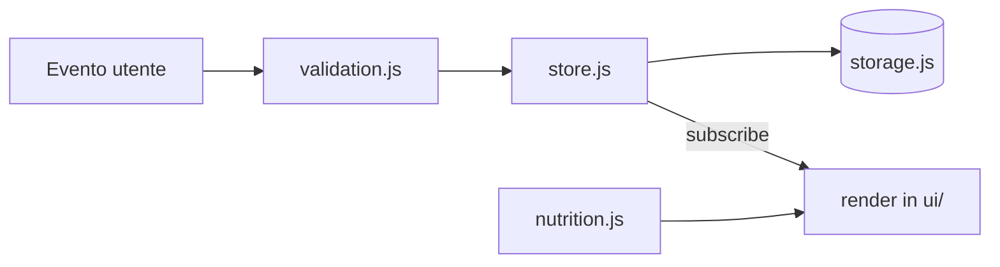

# Fitkia

> Diario alimentare e monitoraggio delle calorie, **mobile-first** e **offline-first**.
> Stato del progetto: 🚧 in sviluppo (pre-alpha)

Un'app gratuita che si differenzia dalle altre tenendo **tutti i dati in locale**, sul dispositivo.

## Indice

1. [Funzionalità](#funzionalità)
2. [Stack tecnologico](#stack-tecnologico)
3. [Architettura](#architettura)
4. [Modello dei dati](#modello-dei-dati)
5. [Per iniziare](#per-iniziare)
6. [Convenzioni](#convenzioni)
7. [PWA e offline](#pwa-e-offline)
8. [Android (Capacitor)](#android-capacitor)
9. [Privacy](#privacy)
10. [Roadmap](#roadmap)
11. [Decisioni architetturali](#decisioni-architetturali)
12. [Crediti e licenza](#crediti-e-licenza)

## Funzionalità

Legenda: ✅ fatto · 🚧 in corso · ⬜ da fare

**MVP**
- ✅ Onboarding: nome, età, peso, altezza (cm), sesso, obiettivo
- ✅ Calcolo del fabbisogno (BMR Mifflin-St Jeor, TDEE, obiettivo perdere/mantenere/aumentare)
- ✅ Dashboard: anello calorie (obiettivo / consumate / rimanenti) e macro (proteine, carboidrati, grassi)
- ✅ Diario pasti: colazione, pranzo, cena, snack
- ✅ Ricerca alimenti nel dizionario locale con calcolo dinamico per grammatura
- ✅ Water tracker
- ✅ Weight log con storico
- ✅ Impostazioni (ricalcolo dei target)
- ✅ Grafico storico del peso con media mobile a 7 giorni (già visibile dalla prima pesata; ogni pesata, anche l'unica rimasta, si può eliminare)

**Dopo l'MVP**
- ✅ To-do giornaliera integratori (es. creatina)
- ✅ Backup e ripristino dei dati in JSON validato, pasti preferiti e "copia da ieri"
- ✅ Affidabilità dei dati locali: migrazioni dello schema (`migrate()` in `storage.js`), avviso persistente se il salvataggio fallisce, promemoria del backup (mai fatto / oltre 14 giorni), richiesta di archiviazione persistente e suggerimento "Aggiungi alla Home" su Safari/iOS
- ✅ Progressi (ex "Diario", la rotta resta `#diary`): ultimi 7 giorni con medie e giorni in target, registrazione e correzione dei giorni passati, grafico del peso con periodo 30g / 90g / Tutto
- ✅ Peso obiettivo e ritmo settimanale (0,25 / 0,5 / 0,75 kg) che determina le calorie, con linea nel grafico e data stimata di arrivo
- 🚧 Pacchetto Android (Capacitor): progetto pronto in `android/`, backup con il menu "Condividi", tasto indietro e icone; resta da provarlo su un telefono

<Todo assignee="Mattia">
  Riordina le voci in base alle tue priorità e sposta in "Dopo l'MVP" ciò che non serve alla prima versione. Un MVP è la versione più piccola che sia *davvero utile a te*.
</Todo>

<Todo assignee="Mattia">
  Aggiungi uno screenshot della dashboard (`docs/dashboard.png`). Puoi usare standard img tag o next/image se usi Next.js!
</Todo>

## Stack tecnologico

| Cosa | Scelta | Perché |
|---|---|---|
| Markup | HTML5 semantico | Accessibilità e SEO di base senza dipendenze |
| Stile | Tailwind CSS (CLI, **compilato**) | Design token in un solo posto; il CDN non è per la produzione e rompe l'offline |
| Logica | JavaScript ES2022 (moduli nativi) | Imparare i fondamentali prima di un framework |
| Dati | `localStorage` (v1) → IndexedDB | Semplice all'inizio; migrabile perché isolato in `storage.js` |
| Offline | Service Worker + Web App Manifest | Installabile e usabile senza rete |
| Test | `node:test` | Zero dipendenze per la logica pura |
| Android | Capacitor (più avanti) | Riusa la stessa web app in una WebView |

## Architettura

### Principio guida

**Core puro, bordi impuri.** I calcoli non sanno che esiste una pagina; tutto ciò che tocca browser (DOM, storage, rete) sta in pochi file di confine.

### Flusso dei dati (a una direzione)



`UI = f(stato)`: la pagina è una rappresentazione dello stato, mai la sua fonte.

### Struttura delle cartelle

```text
fitkia/
├── index.html
├── app.css                  # GENERATO da Tailwind (npm run build:css): si committa, non si modifica a mano
├── tailwind.config.cjs
├── manifest.webmanifest
├── sw.js
├── capacitor.config.json    # app Android: nome, id e cartella web (www/)
├── src/
│   ├── config.js        # costanti, limiti, unità
│   ├── nutrition.js     # logica pura: BMR, target, anello, macro, grafico peso
│   ├── habits.js        # logica pura: acqua, peso, integratori
│   ├── log.js           # logica pura: diario dei pasti
│   ├── backup.js        # logica pura: export/import JSON
│   ├── meta.js          # logica pura: promemoria del dispositivo (ultimo backup, suggerimenti, periodo del grafico)
│   ├── styles/input.css # sorgente degli stili: Tailwind lo compila in app.css
│   ├── validation.js    # logica pura: form grezzo -> dati tipizzati
│   ├── storage.js       # unico file che tocca localStorage
│   ├── native.js        # unico file che parla con Capacitor (app Android): condivisione del backup, tasto indietro
│   ├── store.js         # stato + pub/sub
│   ├── main.js          # bootstrap
│   └── ui/              # DOM: onboarding, dashboard, diario, impostazioni, nav, ...
├── scripts/             # build-www.mjs (cartella www/ per Capacitor), make-icons.mjs (icone PWA e Android)
├── icons/               # icone della PWA (generate da make-icons.mjs)
├── android/             # progetto Android (si apre con Android Studio), creato da Capacitor
├── www/                 # GENERATA (npm run build:www): i file dell'app per Capacitor. Ignorata da git
└── test/
```

### Regole di dipendenza

- `config.js` non importa nessuno.
- `nutrition.js` e `validation.js` importano solo `config.js` (niente DOM, niente storage).
- `storage.js` importa solo `config.js`.
- `native.js` non importa nessuno: è l'unico file che parla con Capacitor, come `storage.js` lo è per `localStorage`. Legge `Capacitor` al momento della chiamata e nel browser non fa nulla.
- `store.js` importa `storage.js` e `config.js`.
- `ui/*` può importare `store`, `nutrition`, `validation`; **nessun altro modulo importa `ui/*`**.
- Solo `main.js` collega le parti.

<Todo assignee="Mattia">
  Aggiungi una regola che ti sembra mancante e spiega perché.
</Todo>

## Modello dei dati

Unità fisse, scritte nei nomi: **kg**, **cm**, **kcal**, **g**.

```js
// Profilo (v1)
{ name, age, weightKg, heightCm, sex: 'male' | 'female', activity, goal }
```

<Todo assignee="Mattia">
  Descrivi qui le altre entità: `FoodEntry` (cosa conservi di un alimento aggiunto: id, nome, grammi, kcal e macro "snapshot"?), `DayLog` (pasti di un giorno), `WeightEntry`, `WaterLog`. Chiediti per ognuna: qual è la chiave? quali campi sono derivati e non vanno salvati?
</Todo>

## Per iniziare

Serve [Node.js](https://nodejs.org) LTS (consigliato installarlo con `fnm`). La prima volta, una sola volta: `npm install`.

```bash
npm install          # scarica Tailwind nella cartella node_modules/ (non si committa)
npm run dev          # genera app.css e serve la cartella su http://localhost:3000 (i moduli ES non funzionano da file://)
npm test             # esegue i test della logica pura
npm run build:css    # rigenera app.css (vedi sotto)
npm run watch:css    # come build:css, ma resta in ascolto e rigenera a ogni modifica
```

### Gli stili: `app.css` si genera, non si scrive

Il CSS dell'app non gira più nel browser: **Tailwind lo compila prima**, e l'app carica un file già pronto (`app.css`). Per questo funziona anche offline al primo avvio.

- `src/styles/input.css` è il sorgente: variabili del tema (chiaro/scuro) e componenti (`.card`, `.chip`...).
- `tailwind.config.cjs` dice a Tailwind quali file leggere (`index.html` e `src/**/*.js`) e definisce i colori.
- Tailwind genera **solo le classi che trova scritte per intero** in quei file. Per questo nel codice le classi variabili sono sempre stringhe intere (`'bg-danger'`), mai costruite a pezzi (`'bg-' + nome`): una classe costruita a pezzi non verrebbe generata.
- `app.css` **si committa**, ma non si modifica a mano. Dopo aver cambiato delle classi in `index.html` o in `src/`, oppure `input.css`, rilancia `npm run build:css` (o tieni acceso `npm run watch:css`).

## Convenzioni

- Funzioni e variabili `camelCase`, costanti `UPPER_SNAKE`, id HTML `kebab-case`.
- Ogni grandezza fisica ha l'unità nel nome (`heightCm`, `weightKg`).
- Una costante o chiave di storage si definisce **una sola volta** in `config.js`.
- Commit in stile [Conventional Commits](https://www.conventionalcommits.org/it/) (`feat:`, `fix:`, `refactor:`, `test:`, `docs:`).

## PWA e offline

- App shell in precache (HTML, CSS, JS, icone, font self-hosted), cache con nome versionato.
- Asset statici: cache-first. Nessuna API esterna: tutto funziona senza rete.
- Pulizia delle vecchie cache in `activate`; avviso "nuova versione disponibile" invece di aggiornare di colpo.

<Todo assignee="Mattia">
  Aggiungi una sezione "Come testare l'offline" (DevTools → Application → Service Workers → Offline).
</Todo>

## Android (Capacitor)

L'app Android è **la stessa web app** dentro una WebView, impacchettata da [Capacitor](https://capacitorjs.com) (versione 8). Il progetto è già pronto nella cartella `android/`.

### Cosa serve (una volta sola)

- **Android Studio** 2025.2.1 o più recente ([developer.android.com/studio](https://developer.android.com/studio)). Include il JDK: non va installato a parte.
- Al primo avvio, il wizard con l'installazione "Standard" scarica l'**Android SDK**. In *Settings → Languages & Frameworks → Android SDK* deve esserci almeno una *SDK Platform* con API 24 o superiore (il progetto compila con la 36).
- Per provare l'app: un **emulatore** (*Device Manager → Create Device*) oppure un **telefono Android** con il "Debug USB" attivo.

### Provarla

```bash
npm run android:sync    # rigenera app.css, ricrea www/ e la copia nel progetto Android
npm run android:open    # apre il progetto in Android Studio
```

In Android Studio attendi la "Gradle sync" (la prima volta scarica diversi GB e può durare parecchi minuti) e premi ▶ **Run**. Dopo ogni modifica a HTML, CSS o JavaScript: `npm run android:sync` e di nuovo ▶. Dopo aver cambiato le icone (`npm run icons`) vale lo stesso.

### Come funziona

- `npm run build:www` copia nella cartella `www/` **solo** i file dell'app (`index.html`, `app.css`, `manifest.webmanifest`, `src/`, `icons/`): niente test, docs né service worker. Un file nuovo fuori da quelle voci non arriva nell'app: va aggiunto in `scripts/build-www.mjs`.
- L'app gira da `https://localhost` dentro la WebView. Il service worker non serve (i file sono già nel pacchetto) e `main.js` non lo registra su `localhost`.
- `src/native.js` è l'unico punto di contatto con Android. Non c'è un bundler: i plugin (`Share`, `Filesystem`, `App`) non si importano, li inietta il ponte di Capacitor in `window.Capacitor.Plugins`.
  - **Backup**: la WebView non scarica file, quindi nell'app il backup si scrive nella cache e si apre il menu **Condividi** di Android (Drive, e-mail, Telegram...). Se l'utente chiude il menu senza scegliere, la data dell'ultimo backup non cambia.
  - **Tasto indietro**: chiude la finestra aperta; poi torna a oggi o alla Home; dalla Home di oggi esce dall'app (logica pura in `router.js`, `backAction`).
- **Dati**: la WebView ha la *sua* `localStorage`, separata da quella del sito o della PWA. Per portare i dati dal browser all'app: *Impostazioni → Scarica backup* nel browser, poi *Ripristina da un backup* nell'app.
- Barre di sistema e tastiera: a tutto schermo con il plugin `SystemBars` di Capacitor 8 (configurato in `capacitor.config.json`); sfondo e schermata di avvio seguono il tema chiaro/scuro (`android/app/src/main/res/values*/colors.xml`, gli stessi colori di `--canvas` in `input.css`).

### Scelte da conoscere

- **`appId` = `it.fitkia.app`**: identifica l'app su Android e sul Play Store e **non si può più cambiare dopo la pubblicazione**. Se vuoi un altro, cambialo ora: `capacitor.config.json`, `android/app/build.gradle` (due punti), `strings.xml` e la cartella `java/it/fitkia/app/` con il `package` di `MainActivity.java`. Un test (`test/android.test.js`) controlla che combacino.
- **`androidScheme: "https"` è fissato**: la `localStorage` è legata all'indirizzo (`https://localhost`); cambiarlo farebbe perdere i dati agli utenti.
- **Backup automatico di Android disattivato** (`allowBackup="false"`): quello di Google copierebbe il diario e il peso nell'account Google dell'utente, contro la promessa "i dati restano sul dispositivo". Il backup è quello manuale (file JSON). Un test lo protegge; per cambiare idea modifica manifest e test.
- Il permesso `INTERNET` è ancora nel manifest (lo mette il modello di Capacitor), ma l'app non fa richieste di rete. Toglierlo renderebbe verificabile "nessun invio di dati"; conviene farlo dopo la prima prova riuscita su un telefono.

### Per pubblicare

- Alza `versionCode` (intero, +1 a ogni rilascio) e `versionName` in `android/app/build.gradle`.
- *Build → Generate Signed App Bundle / APK*. Conserva con cura la chiave di firma (keystore) e la sua password: senza, non si può più aggiornare l'app.

### Icone

Le icone (PWA e Android) si generano da un solo disegno: `scripts/make-icons.mjs`. Per cambiare colori o forma si modifica quel file, poi `npm run icons` e `npm run android:sync`.

## Privacy

Fitkia tratta dati sulla salute. Scelta di progetto: **tutto resta sul dispositivo**, nessun account, nessun invio a server. Le stime caloriche non sono consigli medici. Nell'app Android il backup automatico di Google è disattivato: i dati lasciano il telefono solo per un backup che scegli tu.

<Todo assignee="Mattia">
  Aggiungi export/cancellazione dei dati alla roadmap e decidi come mostrare l'avviso all'utente.
</Todo>

## Roadmap

| Milestone | Contenuto | Stato |
|---|---|---|
| **M0 Fondamenta** | README, `config`, `nutrition`, `validation`, `storage`, `store`, test | ✅ |
| **M1 Onboarding + Dashboard** | Form validato, persistenza, anello e macro dallo stato | ✅ |
| **M2 Diario** | Dizionario cibi, ricerca, grammatura, aggiunta al pasto | ✅ |
| **M3 Salute quotidiana** | Acqua, peso, impostazioni, to-do integratori | ✅ |
| **M4 PWA vera** | Tailwind compilato, font di sistema (niente da scaricare), SW completo, icone nuove nella palette | ✅ |
| **M5 Android** | Capacitor ✅ (progetto `android/`, backup con "Condividi", tasto indietro, icone); restano la prova su un telefono e le notifiche locali | 🚧 |

<Todo assignee="Mattia">
  Per ogni milestone scrivi un "criterio di fatto" (es. M1: "ricarico la pagina e ritrovo i miei dati").
</Todo>

## Decisioni architetturali

Breve registro del *perché* delle scelte, per ricordarle fra sei mesi.

| # | Decisione | Motivo | Compromesso |
|---|---|---|---|
| 1 | Vanilla JS con moduli ES, senza framework | Capire i fondamentali | Il rendering va scritto a mano |
| 2 | Logica pura separata dal DOM | Testabile senza browser | Più file e più indirezione |
| 3 | Un unico store con pub/sub | Una sola fonte di verità | Ridisegna intere sezioni a ogni cambio |
| 4 | `localStorage` isolato in `storage.js` | Migrare a IndexedDB toccando un file | Sincrono e limitato (~5 MB) |
| 5 | Tailwind compilato, non CDN | Offline e prestazioni | Serve un passo di build |

<Todo assignee="Mattia">
  Aggiungi la decisione n. 6 con le tue parole (es. perché `heightCm` e non metri).
</Todo>

<Todo assignee="Mattia">
  Scegli una licenza per il codice (MIT è la più comune) e aggiungi il file `LICENSE`.
</Todo>
